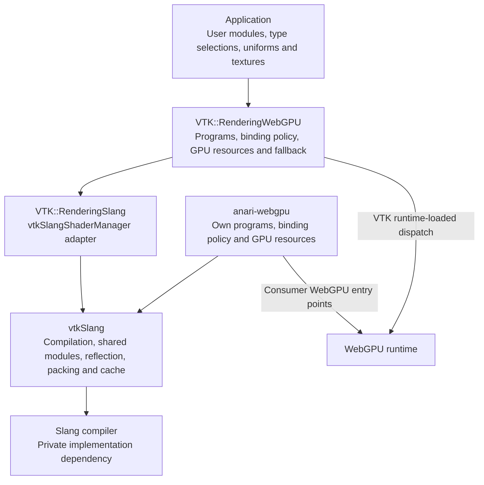

# vtkSlang architecture and VTK integration

## Purpose and scope

vtkSlang provides a shared shader compilation and customization layer for
WebGPU renderers. It compiles renderer-owned Slang programs and user-defined
types into WGSL or SPIR-V, reflects their resource layouts, and provides
utilities for packing shader parameters. VTK and anari-webgpu use the same
shader interfaces and surface shading sequence while retaining their own
rendering pipelines and GPU resource management.

This document describes the library's architecture and the proposed VTK WebGPU
integration. Volume rendering and other planned extensions are identified as
future work. Build instructions and a standalone library example are in
[README.md](README.md).

In VTK, `VTK_USE_SLANG` is an optional build setting that defaults to `OFF`.
With it enabled, applications can select Slang per prop or globally. Global
selection also enables the Slang versions of the supported backend passes.
The existing WGSL path remains the default and provides a fallback.

## Architectural drivers

The design addresses five requirements:

- **Typed customization.** Shader hooks and replaceable shading stages have
  explicit interfaces that Slang checks when compiling a user module.
- **Shared semantics.** VTK and anari-webgpu use common interfaces, defaults
  and shading order so compatible materials and hooks can be reused.
- **Renderer independence.** vtkSlang owns compilation and parameter layout
  utilities. Each renderer owns its programs, binding policy and GPU objects.
- **Discoverable parameters.** Reflection exposes field types, layouts and
  metadata so applications such as ParaView can construct controls without
  prior knowledge of a module.
- **Compatibility.** Opting into Slang should preserve the default appearance.
  The integration's rendering acceptance target is at most 0.1% differing
  pixels relative to the corresponding WGSL path. This is a validation target,
  not a guarantee for arbitrary user shaders.

vtkSlang is a C++17, BSD-3-Clause shared library, currently at version 0.1.0.
Its CMake target is `vtkSlang::vtkSlang`. Slang implementation types are hidden
behind a pImpl and the Slang dependency is linked privately. The compiled
library requires no WebGPU headers and makes no WebGPU calls.

## System context and responsibility boundaries



The arrows show dependencies and calls. Both renderers use vtkSlang without
depending on each other. GPU calls remain on the renderer side of the library
boundary; VTK uses its own runtime-loaded dispatch for every GPU object.

| Component | Responsibility | Boundary |
| --- | --- | --- |
| `vtkSlangCompiler` | Load modules, specialize interfaces, compile programs, return diagnostics and optional reflection, manage sessions and caches | Returns an `Artifact`; does not create GPU objects |
| Shared Slang modules | Define customization interfaces, defaults and the surface shading sequence | Contain no consumer-specific bind group policy |
| Parameter utilities | Build a `BindingPlan`, pack values using reflection, expose a parameter schema | The consumer identifies its own bindings and validates supported resources |
| Reproducer utilities and `vtkslangc` | Capture compilation inputs and results, replay failures, inspect reflection, optionally validate WGSL with tint | Replay does not require the renderer; tint is an external tool |
| `VTK::RenderingSlang` | Adapt the library to VTK conventions through `vtkSlangShaderManager` | Depends on `VTK::CommonCore`; keeps vtkSlang private to this module |
| `VTK::RenderingWebGPU` | Own VTK programs, pipeline variants, binding layouts, resource uploads and fallback | Creates all VTK WebGPU objects |

The optional header-only helper `vtkSlangWebGPU.h` creates shader modules for
consumers that link WebGPU directly. Its calls compile into the consumer;
anari-webgpu uses this helper, while VTK uses its dispatch layer. Keeping the
compiled library independent of WebGPU avoids introducing a second WebGPU
implementation into VTK's process.

## Shader contracts and program ownership

### Shared modules

vtkSlang embeds five shared modules, available by import name in compiler
sessions. Their sources are also installed for editors and other tools.
Renderers own complete programs, entry points and any precompiled artifacts.

| Module | Responsibility | Version constant |
| --- | --- | --- |
| `vtkslang_shading` | Samples, five stage interfaces, `Shading<M,L,N,O,V>` and default implementations | `kShadingInterfaceVersion = 2` |
| `vtkslang_hooks` | `IShaderHooks`, `VertexContext`, `FragmentContext`, `DefaultHooks` and `HookBlock<H>` | `kHooksInterfaceVersion = 1` |
| `vtkslang_surface` | `ISurfaceSource` and the shared vertex and fragment shading sequence | `kSurfaceInterfaceVersion = 1` |
| `vtkslang_attributes` | `[Range]` and `[Label]` metadata for reflected fields | — |
| `vtkslang_core` | `PI`, tone mapping and gamma helpers | — |

The stage interfaces replace complete operations:

| Interface | Operation | Default implementations |
| --- | --- | --- |
| `IMaterial` | Evaluate a `SurfaceSample` into a `MaterialSample` | `HostDrivenMaterial` |
| `ILightingModel` | Compute direct and ambient lighting and resolve radiance | `PhongLighting`, `LambertLighting`, `CookTorranceLighting` |
| `INormalModifier` | Produce the surface normal used for shading | `GeometricNormal` |
| `ISurfaceOutput` | Determine coverage, depth and final color | `StandardOutput` |
| `IVertexModifier` | Modify a vertex before projection | `IdentityVertex` |

`IShaderHooks` supplies smaller insertion points with no-op defaults.
`vertex()` and `position()` run in the vertex stage; `clip()`, `color()`,
`normal()`, `lit()` and `output()` run in the fragment stage. A user type
implements only the hooks it needs.

A program declares global `type_param` parameters for the interfaces it
supports and a `Default_<Interface>` typealias for each default.
`CompileOptions::specializations` maps interface names to user type names;
interfaces omitted from the selection use the program's defaults.

### Shared execution semantics

Each renderer supplies an `ISurfaceSource` adapter for geometry, colors,
lights, ambient radiance and depth. VTK's `VtkSurface` reads VTK's actor
buffer, mesh attributes and lights. The shared module determines when these
inputs and the customization interfaces are evaluated:

1. Apply `IVertexModifier`, then `hooks.vertex()` before projection and
   `hooks.position()` after projection.
2. Evaluate `hooks.clip()`, fetch host colors, then apply `hooks.color()`.
3. Fetch host geometry, apply `hooks.normal()`, and construct the surface sample.
4. Evaluate `ISurfaceOutput::keep()` and compute output depth.
5. Apply `INormalModifier` and evaluate `IMaterial`.
6. Evaluate lighting, or use the unlit path when the source has no lights.
7. Apply the host opacity policy, `hooks.lit()`, `ISurfaceOutput::finish()`
   and `hooks.output()`.

`shadeSurface()` runs the fragment sequence. Compute rasterizers can call
`surfaceCoverage()`, `outputDepth()` and `surfaceShade()` separately to perform
a depth test between coverage and color shading. The sequence avoids early
returns around operations that require uniform control flow in WGSL;
`ISurfaceSource::reject()` implements the host's rejection behavior.

Sample structs provide field defaults to reduce initialization changes when
new fields are added. This does not guarantee binary layout compatibility.
The three interface modules export version constants, but consumers do not
currently enforce them.

### VTK-owned programs

The integration contains 16 programs in `Rendering/WebGPU/slang/`.

| Program | Consumers | Customization interfaces |
| --- | --- | --- |
| `vtkPolyDataSurfaceSlang.slang` | Polydata, composite polydata, glyph and image slice mappers | All five stage interfaces and `IShaderHooks` |
| `vtkLabelsSlang.slang` | Batched labeled data mapper | All except `ILightingModel` |
| `vtkPolyData2DSlang.slang` | 2D polydata and image mappers | All except `ILightingModel` |
| `vtkPointCloudSlang.slang` | Compute point cloud mapper | All except `ILightingModel`; data parameters only, no textures |
| 12 backend pass programs | Background, present, depth readback, skybox, deep framebuffer resolve, point cloud depth copies, cell-to-primitive conversion and culling | No user specialization interfaces |

Pipeline defines such as `VTK_PIPELINE_POINTS`, `VTK_PIPELINE_LINES_THICK`
and `VTK_POINT_NORMALS_BINDING` select variants and their required bindings.
The polydata fragment entry point populates a `FragmentContext` and invokes
`shadeSurface()`.

## Compilation and runtime behavior

### Library compilation flow

The public contracts are defined in [vtkSlangCompiler.h](vtkSlangCompiler.h)
and [vtkSlangParameters.h](vtkSlangParameters.h).

1. The renderer supplies a `Program`: name, source, program modules, entry
   points and optional precompiled artifacts. `compileSource()` also accepts
   source and entry points directly.
2. `CompileOptions` specifies the target, defines, import search paths, user
   modules, specialization selections and whether reflection is required.
3. `compileProgram()` first checks for a precompiled artifact containing code
   for the requested target. This path requires empty defines, search paths,
   user modules and specializations, with reflection disabled. It returns
   without starting Slang.
4. Otherwise, the compiler checks eligible caches, loads the shared and program
   modules, loads user modules, specializes the program and emits target code.
5. The returned `Artifact` contains WGSL or SPIR-V, optional reflected bindings,
   diagnostics, provenance and cache status. Its boolean conversion reports
   success. Compiler diagnostics are returned as text for the host to report.
6. The renderer calls `planBindings(artifact, hostOwned)` to exclude bindings
   it manages itself and obtain uniform blocks, textures, samplers and any
   unsupported bindings. `blockBytes()`, `findField()` and `pack()` construct
   uniform data from the reflected layout.
7. The renderer validates the plan against its binding policy, uploads values
   and creates shader modules, bind groups and pipelines through its GPU API.

`UniformField` describes field paths, offsets, sizes, scalar types, widths,
runs and strides, including nested uniform fields. Packing supports float32,
int32 and uint32 representations; `PackStatus` reports unsupported fields,
scalar mismatches and incompatible shapes. The packer does not infer a layout
or convert scalar representations. `parameterSchema()` exposes the plan and
field attributes as JSON for application controls.

### Sessions and caching

A process-wide Slang global session is initialized lazily under a mutex and
retained for the process lifetime. Each compiler serializes its own calls and
keeps sessions keyed by target, defines and search paths.

Eligible requests use a memory cache and, when `setCacheDirectory()` is set,
a disk cache. Keys include program and module sources, entry points, target,
defines, specialization selections, the reflection flag, Slang version and
the shared-module source hash. Requests with search paths bypass both caches
because imported file contents are not included in the artifact cache key.
Disk entries include the full key and are verified when loaded.

### VTK actor rendering flow

`vtkSlangShaderManager` wraps compilation, diagnostics, reflection, binding
plans, packing and schema access. Only `VTK::RenderingSlang` includes vtkSlang
headers; the WebGPU backend uses VTK types and the manager's mirrored plan.

The actor needs its resource layout before the mapper creates a pipeline.
For the polydata path, preparation and rendering proceed in this order:

1. `PrepareSlangShaders()` compiles the triangle variant and obtains a binding
   plan through `vtkSlangShaderManager`.
2. If the plan changes, the actor rebuilds its group 1 layout and bind groups.
3. Each pipeline type compiles its own variant. The pipeline cache key includes
   the actor's layout signature so incompatible layouts cannot share a pipeline.
4. The actor packs and uploads changed custom uniform values at reflected
   offsets. Value-only changes do not require a pipeline rebuild.

### Error handling and fallback

Fallback policy belongs to VTK; the library returns compilation results.

| Condition | VTK behavior |
| --- | --- |
| A user module or selected type fails compilation | Emit a mapper `ErrorEvent`, suppress repeated identical diagnostics, and retry with the program's default types |
| The default Slang program also fails compilation | Use the WGSL path |
| A selection names an interface the program does not support | Warn and ignore that selection |
| A texture is missing or has an incompatible dimension | Warn and use the WGSL path |
| A backend pass fails compilation | Report the error and use that pass's WGSL program |
| Slang is unavailable | Report the condition and use WGSL |

When `VTK_USE_SLANG=OFF`, `VTK::RenderingSlang` builds a stub.
`IsSlangAvailable()` returns false and compile requests report that VTK was
built without vtkSlang. The WebGPU backend continues to link the same VTK
module and does not need conditional compilation at each call site.

## Resource binding and parameter policy

The library reflects layouts without imposing binding numbers. VTK retains
its renderer, actor, mesh and topology groups. To work within the WebGPU
baseline of four bind groups, custom parameters share the actor's group 1.

| Group 1 bindings | Ownership and contents |
| --- | --- |
| 0–15 | VTK actor data, including its storage buffer, texture and sampler |
| 16 | Shading block: material, lighting, normal, output and vertex fields |
| 17–31 | Shading block textures and samplers |
| 32 | Hook block: fields of the selected `IShaderHooks` type |
| 33 and above | Hook block textures and samplers |

VTK validates uniform blocks at bindings 16 or 32, texture dimensions of 1D,
2D or 3D, and sampler-to-texture pairing. Unsupported layouts are errors.
The 2D program places both customization blocks in group 2 to match its
resource organization.

Parameter paths begin with `hooks.`, `material.`, `lighting.`, `normal.`,
`output.` or `vertex.`. A sampler is paired with the texture declared before
it; VTK takes sampler settings from that texture. Actors also resolve textures
assigned through `vtkProperty::SetTexture()`.

## Configuration and deployment

### VTK configuration and selection

| Setting | Scope | Effect |
| --- | --- | --- |
| `VTK_USE_SLANG=ON` | Configure | Link `VTK::RenderingSlang` to vtkSlang; requires `VTK_ENABLE_WEBGPU` and is unavailable on Emscripten |
| `vtkSlang_DIR` | Configure | Locate a compatible vtkSlang 0.1 CMake package |
| `SetSlangModule()`, `LoadSlangModule()` or a specialization selection | Prop | Request Slang with the supplied customization |
| `UseSlangOn()` | Prop | Request Slang even without a module or specialization |
| `SetGlobalUseSlang()` or `VTK_WEBGPU_SLANG=1` | Process | Enable Slang for props and supported backend passes |
| `VTK_SLANG_CACHE_DIR` | Process | Set vtkSlang's disk cache directory through the VTK adapter |
| `VTKSLANG_DISABLE_SLANG=1` | Process | Make the library report Slang as unavailable; precompiled artifacts remain usable |
| `VTKSLANG_DUMP_DIR` | Process | Enable compilation reproducer bundles |

`VTK::RenderingSlang` links vtkSlang privately and requires a compatible 0.1
package when enabled. anari-webgpu selects a vtkSlang commit through
`FetchContent`. The library first tries `find_package(Slang)` without a
version constraint; if no package is found, its build downloads Slang
2026.13.1. Installed Slang packages can therefore select a different version
from the download fallback.

`VTKSLANG_USE_SLANG=OFF` builds vtkSlang without the compiler. Emscripten
also uses this mode. Consumers must supply precompiled artifacts for that
configuration; runtime user-module compilation is unavailable. anari-webgpu
owns its precompiled WGSL, while the VTK integration does not yet use
`Program::precompiled`.

VTK currently consumes an external vtkSlang package. A ThirdParty module or
superbuild integration remains a packaging decision. Distribution must
account for Slang's binary size and the platform requirements of the chosen
build. Binary sizes and minimum platform versions need release-specific
verification before wheel packaging is decided.

## Quality attributes and validation

**Correctness and compatibility.** Default Slang programs should be checked
against their WGSL counterparts using image comparisons. The 0.1% target
needs coverage across supported mappers, passes and pipeline variants; it
is separate from validating user-defined appearance. Library tests cover
compilation, reflection, parameter packing, schemas and reproducer replay.

**Diagnosability.** Compiler errors retain module locations where available.
`setDumpDirectory()` or `VTKSLANG_DUMP_DIR` enables bundles containing source,
program and user modules, options, output and diagnostics. Compiler cache hits
and failures on that path are captured; the precompiled fast path bypasses it.
`vtkslangc --replay` reproduces a request without running the renderer.

**Generated-code validation.** Successful Slang compilation alone does not
establish that WGSL meets WebGPU validation rules. Slang's WGSL target is
experimental. `vtkslangc` can invoke tint, and optional tests exercise
uniform-control-flow validation. The integration needs CI coverage with Slang
enabled as well as coverage of its stub and fallback paths before Slang becomes
a default.

**Performance.** Compilation and specialization add work during shader and
pipeline preparation. Caching reduces repeated compilation; value-only
parameter changes reuse pipelines. This document establishes no frame-time
or large-mesh performance result. First-frame latency, variant compilation
cost and steady-state rendering require separate measurements.

**Maintainability.** The VTK adapter localizes the external dependency, and
consumer-owned programs keep renderer changes within their repositories.
The library's pImpl hides Slang internals, but changes to public structures
still require compatible consumer builds. Interface-version enforcement and
ABI versioning remain considerations as the API evolves before 1.0.

## Open decisions and planned extensions

| Decision | Current position | Unresolved issue |
| --- | --- | --- |
| Project ownership and releases | vtkSlang is hosted at `sankhesh/vtkSlang` on GitHub | Long-term home, maintainers and release process |
| Slang packaging | Optional external dependency in VTK | Builds for wheels and CI, and ThirdParty versus superbuild integration |
| Binding allocation | VTK reserves customization blocks at 16 and 32 | Confirm the policy for supported and future mapper layouts |
| Legacy string replacement API | WebGPU warns and ignores replacements | Whether unsupported calls should become errors |
| Serialization | Specializations and textures are excluded from marshalling | How shader configuration and resources should be serialized |
| Interface compatibility | Shared modules export version constants | When and how consumers should validate them |
| Slang as the default | WGSL remains the default | Packaging, validation coverage, first-frame cost and precompiled defaults |

Planned extensions include shared volume interfaces (`IVolumeSampler` and
`ITransferFunction`) for the WebGPU volume mapper, a GLSL target for OpenGL,
precompiled default programs for WebAssembly and startup cost, a common
material catalog with cross-renderer reference images, and texture parameters
for the point cloud compute path. These are future capabilities rather than
requirements satisfied by the current integration.

## Appendix A: Application customization examples

An application supplies a Slang module, specialization type names, custom
uniforms and textures through `vtkWebGPUShaderProperty`. The supported mappers
read these settings through the same API, which is wrapped for Python.

### Hook customization

`Stripes` overrides one hook; the remaining methods retain their no-op
defaults. `positionVC` is available in `FragmentContext` for both lit and
unlit paths.

```cpp
prop->SetSlangModule(R"(
  module my_hooks;
  import vtkslang_hooks;
  public struct Stripes : IShaderHooks {
    float3 tint;
    public override void color(inout FragmentContext f) {
      if (frac(f.positionVC.y * 4.f) > 0.5f)
        f.diffuseColor = tint;
    }
  };)");
prop->SetSlangSpecialization("IShaderHooks", "Stripes");
prop->GetFragmentCustomUniforms()->SetUniform3f("hooks.tint", rgb);
```

An invalid override is diagnosed in the supplied module. For example,
renaming `color` to `colour` produces a diagnostic of this form:

```text
error[E30854]: 'colour' marked as 'override' is not overriding any base declarations
 --> renamed_hooks.slang:5:24
```

### Material and texture parameters

`Ramp` implements `IMaterial` and starts from `HostDrivenMaterial` so
`vtkProperty` values still apply. `[Range]` and `[Label]` reach the parameter
schema, allowing a UI to construct a slider without changing shader behavior.

```slang
module ramp;
import vtkslang_shading;

public struct Ramp : IMaterial {
  Texture2D ramp;
  SamplerState rampSampler;
  [Range(0, 1)] [Label("Mix")] float amount;

  public MaterialSample evaluate(SurfaceSample s) {
    MaterialSample m = HostDrivenMaterial().evaluate(s);
    float3 c = ramp.SampleLevel(rampSampler, float2(s.uv.x, 0.5f), 0.f).rgb;
    m.baseColor = lerp(m.baseColor, c, amount);
    return m;
  }
};
```

```python
prop = actor.GetShaderProperty()
prop.LoadSlangModule("ramp.slang")
prop.SetSlangSpecialization("IMaterial", "Ramp")
prop.SetSlangTexture("material.ramp", ramp_texture)
prop.GetFragmentCustomUniforms().SetUniformf("material.amount", 0.6)
```

`material.ramp` identifies the texture field, and `material.amount` identifies
the uniform field. The paired `rampSampler` uses the texture's sampler settings.

### Compute pass

`vtkWebGPUComputePass` accepts Slang source alongside its WGSL source and
uses WGSL if Slang compilation fails. Bindings follow the order in which
buffers are added, preserving the existing resource setup API.

```cpp
pass->SetSlangShaderSource(R"(
  [vk::binding(0, 0)] StructuredBuffer<float> input;
  [vk::binding(1, 0)] RWStructuredBuffer<float> output;
  [shader("compute")] [numthreads(32, 1, 1)]
  void computeMain(uint3 id : SV_DispatchThreadID) { output[id.x] = 2.f * input[id.x]; })");
pass->SetShaderEntryPoint("computeMain");
```

## Appendix B: OpenGL customization mapping

The integration maps OpenGL polydata customization points to typed hooks and
stage interfaces. The table describes the intended correspondence; the
shader languages and generated plumbing remain different.

| `IShaderHooks` method | Runs | OpenGL tags it replaces | Higher-level interface |
| --- | --- | --- | --- |
| `vertex()` | Vertex stage, before projection | `CustomBegin`, `Normal`, `TCoord`, `Color` | `IVertexModifier` |
| `position()` | Vertex stage, after projection | `PositionVC`, `CustomEnd` |  |
| `clip()` | Fragment stage, first; false discards | `Clip` | `ISurfaceOutput` |
| `color()` | After VTK's colors, scalars and textures | `Color`, `TCoord`, `TMap` | `IMaterial` |
| `normal()` | After VTK's normal and edges | `Normal`, `Edges` | `INormalModifier` |
| `lit()` | After lighting | `Light`, `PBR` | `ILightingModel` |
| `output()` | Last: color, depth, picking ids | `Depth`, `Coincident`, `Picking`, `PrimID` | `ISurfaceOutput` |

Uniform declarations become fields of the hook type. `System`, `Output`,
`UniformFlow`, `ValuePass` and the GLES 3.0 tags affect GLSL plumbing generated
by Slang and have no direct customization counterpart.

## Appendix C: VTK API inventory

The integration adds APIs without removing or deprecating existing public APIs.
The inventory describes the proposed VTK API and does not constitute a released
VTK API guarantee.

### New API

| Where | Added |
| --- | --- |
| `vtkWebGPUUniforms` | Factory override of `vtkUniforms` for the WebGPU backend |
| CMake | `VTK_USE_SLANG` (default `OFF`; needs `VTK_ENABLE_WEBGPU`, not on Emscripten) and `vtkSlang_DIR` |
| `VTK::RenderingSlang` | New module with `vtkSlangShaderManager` |
| `vtkWebGPUShaderProperty` | `SetSlangModule()`, `GetSlangModule()`, `LoadSlangModule()`, `HasSlang()`; `UseSlang` with `UseSlangOn()`/`UseSlangOff()` |
| `vtkWebGPUShaderProperty` | `SetSlangSpecialization()`, `GetSlangSpecialization()`, `RemoveAllSlangSpecializations()`, `GetNumberOfSlangSpecializations()`, `GetNthSlangSpecializationInterface()`, `GetNthSlangSpecializationType()` |
| `vtkWebGPUShaderProperty` | `AddSlangSearchPath()`, `RemoveAllSlangSearchPaths()`, `GetNumberOfSlangSearchPaths()`, `GetNthSlangSearchPath()` |
| `vtkWebGPUShaderProperty` (static) | `SetGlobalUseSlang()`, `GetGlobalUseSlang()`, `GlobalUseSlangOn()`/`Off()`; `VTK_WEBGPU_SLANG=1` sets the first value |
| `vtkWebGPUPolyDataMapper` | Public static `GetSlangShaderSource()`; protected `PrepareSlangShaders()`, virtual `BuildSlangShaders()` and `GetSlangDefines()`, static `GetShaderStateMTime()` |
| `vtkWebGPUShaderProperty` | `SetSlangTexture()`, `GetSlangTexture()`, `RemoveAllSlangTextures()`, `GetNumberOfSlangTextures()`, `GetNthSlangTextureName()` |
| `vtkWebGPUActor` | `GetNumberOfSlangParameters()`, `GetSlangParameterName()`, `GetSlangParameterType()`, `GetSlangParameterAttributes()`, `GetSlangParameterSchema()` |
| Environment | `VTK_SLANG_CACHE_DIR` for vtkSlang's disk cache |
| `vtkWebGPUPolyDataMapper` | Protected virtual `GetSlangProgramSource()`; `vtkWebGPUBatchedPolyDataMapper` overrides `GetSlangDefines()` |
| `vtkWebGPUComputePass` | `SetSlangShaderSource()`, `GetSlangShaderSource()`, `SetSlangShaderSourceFromPath()` |

### Behavior changes

| Where | Before | After |
| --- | --- | --- |
| Custom uniforms under WebGPU (`GetFragmentCustomUniforms()` and the rest) | Every call warned and dropped the value | Values are stored with OpenGL's rules |
| `vtkWebGPUShaderProperty::Add*ShaderReplacement()`, `Set*ShaderCode()` | Silently ignored | Warn and are ignored |
| `vtkWebGPUImageSliceMapper`, `vtkWebGPUImageMapper`, batched labeled data mapper | Their prop's shader property never reached the proxy actor that draws | Forwarded on each render |
| `vtkWebGPUComputePass::SetShaderSource()` | A new source after the first dispatch was ignored | Rebuilds the shader module, bind groups and pipeline |

The prototype names, including `VTK_WEBGPU_SLANG_SURFACES` and
`UseSlangSurfaceShading`, were not public APIs on VTK master and require no
compatibility shims. Slang specializations and textures are currently excluded
from marshalling (`VTK_MARSHALEXCLUDE`); serialized shader properties do not
preserve them.
